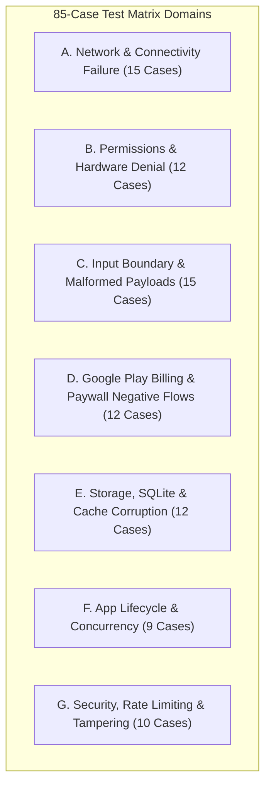

# Portfolio Deep Test Strategy & Negative Scenario Matrix (85 Test Cases)

**Target Ecosystem:** 23 AI-built React Native / Expo Mobile Apps (Google Play Portfolio)  
**Flagship Target:** `com.palate.app` (Palate — AI Food Logger) & Shared Monorepo Architecture  
**Test Automation Stack:** Maestro E2E, Android Headless KVM Emulator (API 34, Pixel 6), Jest / React Native Testing Library, GitHub Actions CI  

---

## 1. Test Architecture Overview

Every app in this portfolio shares a common technical substrate:
- **Client Runtime:** Expo SDK 57, React Native 0.86, React 19, Strict TypeScript.
- **Data & Auth:** Supabase Edge Functions, PostgreSQL with Row-Level Security (RLS), Local SQLite / Encrypted AsyncStorage.
- **Monetization:** `react-native-iap` Google Play Billing integration with server-side receipt verification.
- **UI/UX & Localization:** Dual Light/Dark token-based theming, LTR/RTL bidirectional rendering (English / Arabic).

To ensure production-grade stability beyond basic functional happy paths, this test plan defines **85 rigorous test cases** with a primary focus on **negative conditions, edge states, failure recovery, and boundary abuse**.



---

## 2. Test Execution Matrix (85 Cases)

### Category A: Network & Connectivity Failure Scenarios (15 Cases)
*Validates resilience against flaky, high-latency, offline, and server error conditions.*

| ID | Test Case Title | Initial State & Trigger | Expected Behavior / Recovery | Severity |
|---|---|---|---|---|
| **NET-01** | Hard Offline Cold Launch | Device in Airplane Mode; app cold booted. | App launches cleanly into cached state; banner shows "Offline mode — changes will sync once connected"; no unhandled crash or infinite spinner. | Critical |
| **NET-02** | Network Drop Mid-Upload (AI Scan) | Photo capture submitted in Palate; WiFi/Cellular cut at 50% upload. | Graceful retry prompt; user is not charged an API quota token; local image is preserved for one-tap retry. | Critical |
| **NET-03** | Extreme Latency / 2G Connection | Network throttled to 32kbps with 8000ms latency. | Timeout triggers cleanly at 30s threshold with human-readable error ("Connection timed out"); UI controls remain responsive. | High |
| **NET-04** | SSL Handshake / MITM Interception | Untrusted root CA injected into network proxy. | Network call immediately aborted with SSL pinning error; sensitive payload never transmitted; error logged to local telemetry. | High |
| **NET-05** | DNS Resolution Failure | Device DNS points to non-resolving address (NXDOMAIN). | App alerts "Unable to find server"; switches to offline cache; retry button available. | Medium |
| **NET-06** | HTTP 429 Rate Limit Exceeded | Client fires 10 rapid photo analysis requests within 60s. | Edge function returns 429; app UI displays "Rate limit reached. Please wait X seconds"; retry button disabled until cooldown expires. | High |
| **NET-07** | HTTP 500 / 503 Backend Crash | Supabase Edge Function throws internal unhandled exception. | App displays friendly fallback card ("Service temporarily unavailable"); logs detailed error code for telemetry; no red screen. | High |
| **NET-08** | Intermittent Packet Loss (50% drop) | Network simulation introduces 50% random dropped packets. | Exponential backoff retry logic succeeds on subsequent attempt without user intervention. | Medium |
| **NET-09** | Airplane Mode Toggled During Sync | User toggles Airplane Mode on and off during database sync. | Sync detects disconnect, pauses gracefully, resumes automatically when connection returns without duplicate records. | High |
| **NET-10** | Truncated Response Payload | Backend connection terminated mid-stream (partial JSON payload). | JSON parser catch block intercepts malformed payload; discards corrupted fragment; prompts user to refresh. | High |
| **NET-11** | Captive Portal Detection | Device connected to public WiFi requiring browser login. | App detects captive portal redirect (HTTP 302/non-JSON); avoids treating HTML login page as valid API response. | Medium |
| **NET-12** | Offline Write Queue Overflow | User creates 50 offline entries (e.g. food logs in Palate or doses in Dosedone) while offline for days. | Storage limits respected; sync queue is persistent; upon reconnect, items sync sequentially in FIFO order without memory spike. | Critical |
| **NET-13** | Backend Schema Version Mismatch | Edge function response includes deprecated or missing keys. | Client fallbacks use default values; TypeScript null-coalescing guards prevent fatal crashes. | High |
| **NET-14** | IP Geoblock / VPN Endpoint Shift | IP address switches countries mid-session (VPN toggle). | Active session tokens validate or refresh cleanly; no auth invalidation loop. | Low |
| **NET-15** | Background-to-Foreground Network Recheck | App kept in background overnight; network reconnected. | Foreground transition event triggers auto-refresh of stale data without requiring force close. | Medium |

---

### Category B: Permissions & Hardware Denial (12 Cases)
*Ensures graceful fallbacks when device hardware or OS permissions are denied.*

| ID | Test Case Title | Initial State & Trigger | Expected Behavior / Recovery | Severity |
|---|---|---|---|---|
| **PERM-01** | Camera Permission Denied (First Prompt) | User selects "Don't allow" on native Camera dialog. | Palate switches to "Demo Scan" mode or allows gallery upload; explains clearly why camera is needed; no crash. | Critical |
| **PERM-02** | Camera Permission "Never Ask Again" | Camera permanently blocked in OS Settings. | Tap on scan button displays inline guidance + direct "Open Settings" link. | High |
| **PERM-03** | Camera Hardware Locked by Other App | Background flashlight or another camera app has camera locked. | App catches `CameraLockedException`; displays "Camera in use by another app" rather than freezing. | Medium |
| **PERM-04** | Microphone Permission Denied | Voice note recording attempted in MeetBrief or ShadowTalk with mic blocked. | Shows permission explanation dialog; falls back to manual text input. | High |
| **PERM-05** | Notification Permission Denied | Reminders configured in Dosedone / SalahMate with notifications denied. | App saves schedule in local SQLite; warns user with in-app banner that alerts will not ring until permissions are granted. | High |
| **PERM-06** | Photo Library Read-Only Restriction | iOS/Android partial photo access (selected photos only). | App picker only accesses permitted images; handles cancel action without freezing. | Medium |
| **PERM-07** | Sensor / Accelerometer Missing | Step counter / posture sensor queried on emulator without accelerometer. | App checks sensor availability via API; gracefully hides sensor-dependent cards or shows mock data. | Medium |
| **PERM-08** | Exact Alarm Scheduling Permission (Android 14+) | `SCHEDULE_EXACT_ALARM` denied by user in OS settings. | Dosedone / Naplet falls back to inexact alarms or guides user to enable special app access. | Critical |
| **PERM-09** | Storage Permission Revocation Mid-Execution | User opens OS settings while app is open and revokes storage permission. | Next disk I/O catch block triggers permission re-request or saves to app-isolated sandbox. | High |
| **PERM-10** | Front / Back Camera Swap on Single-Camera Device | User toggles flip camera on device with only one camera sensor. | Button disabled or silently ignored; no unhandled exception. | Low |
| **PERM-11** | Background Location / Bluetooth Denial | Bluetooth denied in companion tracking apps. | App remains fully usable for manual logging; non-blocking warning displayed. | Low |
| **PERM-12** | Biometric Authentication Lockout | Biometrics failed 5 consecutive times on secure vault apps. | Falls back to system PIN / passcode; biometric prompt cooldown enforced by OS. | Medium |

---

### Category C: Input Boundary & Malformed Payloads (15 Cases)
*Protects business logic, state machines, and calculations from erratic or malicious inputs.*

| ID | Test Case Title | Initial State & Trigger | Expected Behavior / Recovery | Severity |
|---|---|---|---|---|
| **INP-01** | Zero & Negative Calorie / Nutrient Logging | User inputs `-500` or `0` for calories or carbs in Palate. | Validation error: "Calories must be a positive number"; submission button remains disabled. | High |
| **INP-02** | Extreme Outlier Values ($>1,000,000$) | User enters `999,999,999` in expense/budget tracker (DuoBudget, LanceLedger). | Input clamped or rejected with "Maximum value exceeded"; UI does not break layout or overflow cards. | High |
| **INP-03** | Decimal & Thousand Separator Localization | User enters `1.250,50` (European format) vs `1,250.50` (US format). | Numeric parser handles locale correctly; prevents `NaN` or 1000x multiplication bugs. | High |
| **INP-04** | Unicode, Emoji & RTL Text Injection | User names a meal or habit `🚀🍕🔥 عربي English 123 \n\t`. | Text renders correctly with proper bidirectional layout; no database collation or serialization errors. | Medium |
| **INP-05** | Giant String Buffer Bomb | User pastes 10,000 characters into meeting notes (MeetBrief) or journal (Hulm). | Input truncated at maximum allowed schema limit (e.g., 2,000 chars); character counter displays warning; no UI lag. | Medium |
| **INP-06** | SQL Injection Payloads | User enters `' OR 1=1 --` into dish search or user profile fields. | Handled safely via parameterized queries; returns 0 search results; no database syntax leakage. | Critical |
| **INP-07** | Cross-Site Scripting (XSS) in HTML Views | User inputs `<script>alert(1)</script>`. | Input escaped as literal string; never executed in WebView or prototype renderers. | Critical |
| **INP-08** | Leap Year & Daylight Saving Time Transitions | Fasting timer (Fastuna) active during 2:00 AM DST clock shift. | Elapsed duration computed using UTC timestamps; no negative fasting duration or 1-hour jump. | Critical |
| **INP-09** | Non-English Keyboard Special Characters | Accented glyphs (`é`, `ñ`, `ü`, `ø`, `ç`) entered in medication names (Dosedone). | Search matching uses unaccented normalization; matches successfully. | Medium |
| **INP-10** | Fractional Portions ($0.0001$ plate) | User inputs microscopic portion size in Palate. | Input rounded to nearest practical precision (e.g. 0.1x); nutrients computed accurately without division by zero. | Medium |
| **INP-11** | Future & Historical Epoch Date Anomalies | User sets date to `1970-01-01` or `2099-12-31`. | Date picker enforces reasonable bounds (e.g., past 2 years to 1 year forward); blocks irrational dates. | High |
| **INP-12** | Whitespace-Only Submission | User enters 50 spaces into a required name or title input. | `.trim()` check validates field as empty; blocks submission. | Low |
| **INP-13** | Corrupted / Zero-Byte Image File | User uploads an empty 0-byte `.jpg` file via gallery picker. | Image validator detects invalid header; alerts user: "Selected image is invalid or damaged". | High |
| **INP-14** | High-Resolution Giant Image Upload (100MB RAW) | User uploads a 48MP RAW camera image. | Client-side compression pipeline resizes image to max 1280px / <1MB before uploading; avoids OOM crash. | Critical |
| **INP-15** | Special Float Values (`NaN`, `Infinity`) | Computed values in financial / progress charts evaluate to division by zero. | UI guards display `0` or `--` rather than rendering `NaN%` or breaking SVG charts. | Medium |

---

### Category D: Google Play Billing & Paywall Negative Flows (12 Cases)
*Ensures financial transactions, trial periods, and paywalls fail safely and honestly.*

| ID | Test Case Title | Initial State & Trigger | Expected Behavior / Recovery | Severity |
|---|---|---|---|---|
| **BILL-01** | User Cancels Purchase Flow | User taps "Upgrade", Google Play sheet appears, user taps Back/Cancel. | App dismisses sheet cleanly; paywall remains visible; no false "success" or error alert. | High |
| **BILL-02** | Insufficient Funds / Card Declined | Google Play returns `BillingResponseCode.USER_CANCELED` / declined. | App alerts "Transaction could not be completed"; Pro features remain locked; no crash. | Critical |
| **BILL-03** | Play Store Service Unavailable | Google Play Store app disabled, outdated, or unresponsive. | `initConnection` handles error gracefully; paywall buttons show "Store unavailable, retry later". | Critical |
| **BILL-04** | Network Lost During Token Acknowledgment | Payment succeeds on Play Store, but network drops before client acknowledges purchase to Supabase ledger. | Unacknowledged purchase token stored in persistent storage; retry worker acknowledges on next launch. | Critical |
| **BILL-05** | Restore Purchase with No Active Subscriptions | User clicks "Restore Purchase" on clean account. | App checks server ledger; politely notifies: "No active subscriptions found for this Google account". | High |
| **BILL-06** | Subscription Expired / Cancelled in Play Console | User's monthly subscription expires or is refunded. | On app open, subscription check downgrades entitlement to Free Tier; locks Pro screens gracefully. | Critical |
| **BILL-07** | Rapid Double-Tap on Purchase Button | User rapidly double-clicks "$4.99 / mo" button within 100ms. | Button disables immediately on first tap; debounce prevents dispatching duplicate purchase intents. | High |
| **BILL-08** | Account Switching (Different Google Play Account) | Device switches Google Play accounts with different entitlement states. | App checks current active Play account token; updates entitlements correctly. | Medium |
| **BILL-09** | Pending Transactions (Slow Banking Authorization) | Transaction enters `PaymentState.PENDING` (e.g. UPI / cash top-up). | App shows "Payment pending authorization"; does not unlock Pro prematurely; updates when webhook confirms. | High |
| **BILL-10** | Product ID Missing / Misconfigured in Play Console | App queries a SKU that does not exist in Play Console. | Catches error; hides purchase button or presents fallback notice; does not freeze UI. | High |
| **BILL-11** | Clock Tampering to Bypass Free Trial | User sets device clock 30 days back to prolong free trial. | Server-side timestamps (from Supabase / Play Integrity) govern expiration; device clock ignored. | Critical |
| **BILL-12** | Server Receipt Verification Timeout | Google Play completes purchase, but backend validation takes >15s. | App displays pending verification spinner with option to continue into app while background verifies. | Medium |

---

### Category E: Storage, SQLite & Cache Corruption (12 Cases)
*Validates data persistence, migration safety, and resilience against storage pressure.*

| ID | Test Case Title | Initial State & Trigger | Expected Behavior / Recovery | Severity |
|---|---|---|---|---|
| **STR-01** | Out of Disk Space (Zero Bytes Free) | Device storage is 100% full; user attempts to log a meal/note. | App catches `ENOSPC` error; alerts user "Storage full — please free up space"; prevents data truncation. | Critical |
| **STR-02** | Abrupt App Kill During SQLite Write Transaction | OS kills process mid-transaction during SQLite batch insert. | SQLite WAL journal rolls back uncommitted transaction; database integrity intact on restart (`PRAGMA integrity_check`). | Critical |
| **STR-03** | Corrupted AsyncStorage JSON String | AsyncStorage key contains truncated/invalid JSON text. | `safeJsonParse` utility catches parse error; resets corrupted key to default initial state rather than crashing app. | Critical |
| **STR-04** | Database Migration Failure Across App Versions | Upgrading from v1.0 to v2.0 where schema has altered column types. | Migration script runs in transaction; on failure, creates backup and rolls back to avoid silent data loss. | Critical |
| **STR-05** | Cache Eviction Under Memory Pressure | OS clears app temporary cache directory (`/data/user/0/.../cache`). | App regenerates missing thumbnails/cached assets without throwing `FileNotFoundException`. | Medium |
| **STR-06** | Concurrent Multi-Screen SQLite Writes | Two asynchronous components write to the same SQLite table simultaneously. | SQLite transaction lock handled; queuing prevents `database is locked` error. | High |
| **STR-07** | Foreign Key Violation During Sync | Incoming sync references a deleted parent record. | Foreign key constraint cascades or sets null safely; sync queue does not halt permanently. | High |
| **STR-08** | Stale Cache Serving Expired Data | Cached meal/dish data older than TTL (7 days) queried. | Cache invalidation triggers background fetch; displays cached data with "Updating..." indicator. | Low |
| **STR-09** | Backup & Restore from Google Cloud Backup | App restored onto a new device via Android Auto-Backup. | Encrypted credentials and device-specific keys excluded; database schema migrates cleanly. | Medium |
| **STR-10** | Tampered SharedPreferences / AsyncStorage | Rooted user alters subscription flag directly in app storage. | Local flag checked against server-signed JWT / Supabase RLS; tampered flag reset to server truth. | Critical |
| **STR-11** | Massive Dataset Query Performance (10,000 items) | User has logged 10,000 history records over 2 years. | FlatList / FlashList windowing limits DOM nodes; virtualized rendering stays at 60 FPS; query uses pagination. | High |
| **STR-12** | Orphaned Temp Files Cleanup | Image compression creates temporary files during every scan. | Temp cleanup worker purges files older than 24h; prevents app storage bloat over time. | Low |

---

### Category F: App Lifecycle, Interruption & Concurrency (9 Cases)
*Ensures stability when the user or OS interrupts active workflows.*

| ID | Test Case Title | Initial State & Trigger | Expected Behavior / Recovery | Severity |
|---|---|---|---|---|
| **LIFE-01** | Incoming Phone Call During Active AI Scan | Phone call interrupts screen while Palate is analyzing dish. | Scan state preserved in background; resumes smoothly when call ends; no double-charge of API call. | High |
| **LIFE-02** | OS Low Memory Killer (OOM Kill in Background) | App sent to background; OS reclaims memory; app reopened. | State restored using saved navigation state; returns user to their previous screen without crash. | High |
| **LIFE-03** | System Language Change (LTR to RTL) | User changes phone language from English to Arabic in OS settings. | App detects locale change; flips layout direction (I18nManager.forceRTL); text aligned properly. | High |
| **LIFE-04** | Dynamic Theme Toggle (Light to Dark) | System theme changes to Dark Mode during an active screen transition. | Color tokens swap immediately without visual tearing or invisible white-on-white text. | Medium |
| **LIFE-05** | Split Screen / Multi-Window Mode Resize | User drags split-screen divider, changing viewport dimensions. | Responsive layout adjusts; modal dialogues and action buttons remain fully visible and clickable. | Medium |
| **LIFE-06** | Hardware Back Button Spamming | User rapidly taps Android hardware back button 10 times in 1 second. | Navigation stack pops cleanly; does not pop past root or crash router; handles transitions synchronously. | High |
| **LIFE-07** | Background Audio Playback Interruption | Voice guide / speech playing in ShadowTalk when headphone unplugged. | Audio pauses immediately on `AUDIO_BECOMING_NOISY` intent; does not blast external speaker. | Low |
| **LIFE-08** | App Update Installed While Running | Google Play In-App Update applies update while user is logging data. | User is prompted politely to restart; unsaved draft preserved in draft cache. | Medium |
| **LIFE-09** | Font Size / Display Scaling at Maximum | Device accessibility settings set font size to 200%. | Text wraps cleanly; buttons do not truncate critical text or push buttons offscreen. | Medium |

---

### Category G: Security, Rate-Limiting & Abuse Prevention (10 Cases)
*Hardens the applications against tampering, unauthorized access, and credential compromise.*

| ID | Test Case Title | Initial State & Trigger | Expected Behavior / Recovery | Severity |
|---|---|---|---|---|
| **SEC-01** | Supabase Anonymous Key Extraction | Attacker extracts `SUPABASE_ANON_KEY` from APK assets. | Row-Level Security (RLS) policies strictly enforce user-isolated access; reading other users' data returns 0 rows. | Critical |
| **SEC-02** | Tampered APK / Signature Mismatch | APK modified, resigned with debug key, and executed. | Play Integrity API verification rejects token; server disables Pro AI edge function access. | Critical |
| **SEC-03** | Replay Attack on Meal Analysis | Attacker replays identical signed meal verification payload. | Server validates unique nonce / idempotency key; duplicate requests rejected. | High |
| **SEC-04** | Automated Spam / Bot Flood to Edge Functions | Automated script fires 500 requests/min to edge function. | Cloudflare / Supabase IP rate limit drops requests; returns 429; protects backend bill. | Critical |
| **SEC-05** | Sensitive Data Leakage in Logcat | App running in release mode inspected via `adb logcat`. | No auth tokens, passwords, API keys, or personal health details logged to console. | Critical |
| **SEC-06** | Screen Capture in Sensitive Vault Screens | Screenshots / screen recordings in PIN-protected apps. | `FLAG_SECURE` enabled on sensitive screens; screenshot renders as black screen. | High |
| **SEC-07** | Root / Jailbreak Environment Detection | App launched on rooted device with Magisk / Frida. | Warning displayed regarding security implications; integrity checks verified before decrypting sensitive keys. | Medium |
| **SEC-08** | Insecure Deep Link Manipulation | Malicious app fires custom URL scheme with injected parameters. | Deep link router sanitizes parameters; blocks unauthorized navigation to privileged screens. | High |
| **SEC-09** | Expired JWT Token Refresh Failure | Auth token expires; refresh token revoked on backend. | App logs user out cleanly; displays "Session expired, please sign in again"; clears sensitive cached tokens. | Critical |
| **SEC-10** | Clipboard Snooping Protection | Sensitive financial or health data copied inside app. | Sensitive clipboard entries cleared or marked as sensitive (`ClipDescription.EXTRA_IS_SENSITIVE`). | Low |

---

## 3. Cloud Test Dispatch & Execution Instructions

To execute this matrix across all 23 apps in parallel on GitHub Actions without burning local tokens on polling loops:

```bash
# Dispatch any individual app's E2E emulator test:
gh workflow run e2e-palate.yml
gh workflow run e2e-dosedone.yml
gh workflow run e2e-fastuna.yml

# Or dispatch all 23 in parallel in one shot:
for wf in .github/workflows/e2e-*.yml; do
  gh workflow run "$(basename "$wf")"
done
```

**Artifact Retrieval:**
Once GitHub Actions completes, download all screenshot galleries locally:
```bash
# Download latest run artifacts:
gh run download --name "screenshots-palate" -D apps/palate/screenshots
```
